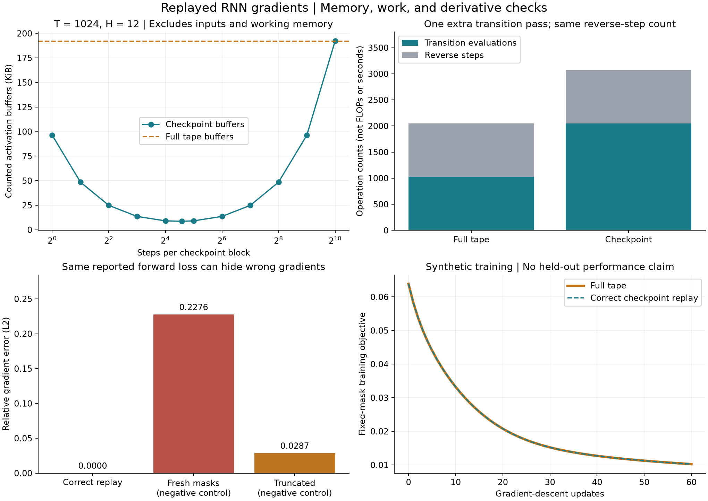

# Replayed RNN gradients

**Recompute activations without changing the gradient.** This project implements
manual reverse-mode differentiation for a small tanh recurrent network, then
replaces its full activation tape with periodic checkpoints. It verifies that
dropout masks are replayed at the same absolute time indexes and that state
derivatives pass correctly across checkpoint boundaries.

The original NumPy implementation demonstrates recurrent differentiation,
memory accounting, deterministic random replay, and independent derivative
checks. Activation checkpointing and backpropagation through time are established
methods; this is not a new training algorithm or a framework performance claim.
All examples use **deterministic synthetic sequences and seeded initialization**.
There are no external/private datasets or empirical internship/research claims.



## Reproduce

Python 3.11 and 3.13 are tested in CI. The core requires NumPy; the pinned
requirements also include pytest and Matplotlib with plotting dependencies.
No automatic-differentiation framework or GPU is needed.

```bash
python3 -m venv .venv
source .venv/bin/activate
python -m pip install -r requirements.txt
python -m pip install --no-deps .
python -m pip check
python -m pytest -q
python examples/demo.py --output results
rnn-gradient-audit --length 128 --hidden 8 --block-size 16 --dropout 0.25 --seed 17
```

The demo produces [metrics.json](results/metrics.json) and the figure. The CLI
prints a compact gradient, buffer, and work audit on a freshly generated
synthetic problem. It checks the correct checkpoint gradient against the full
tape and exits with an error if the comparison fails. Negative controls are
reported as diagnostics, not accepted as valid full-objective gradients.

## Model and objective

There is one sequence, with `T` steps, input width `D`, hidden width `H`, and
output width `O`. All computation uses float64. At step `t`:

```text
a_t = tanh(W_h h_(t-1) + W_x x_t + b)
h_t = m_t * a_t
prediction_t = W_y h_t + c

L = sum_t ||prediction_t - y_t||^2 / (2 T)
    + (lambda / 2) * sum_over_all_five_parameter_arrays ||parameter||^2
```

Multiplication by `m_t` is elementwise. Each mask entry is zero with probability
`p`, or `1/(1-p)` otherwise (inverted dropout). This is independent **per-time
state dropout**, not a locked/variational mask or a framework-specific RNN
dropout convention. The loss averages over time and **sums** output channels.
Regularization includes both weight matrices and biases; `h0` is not regularized.

Results contain the loss, derivatives for `wx`, `wh`, `b`, `wy`, `c`, and the
initial-state derivative. The masks are held fixed while differentiating. The
result is a derivative for one realized mask sequence, not an evaluated
expectation over all dropout outcomes.

```python
import numpy as np
from replayed_rnn import full_gradient, checkpoint_gradient
from replayed_rnn.experiment import synthetic_problem

params, x, y, h0 = synthetic_problem(length=37, hidden=6, seed=17)
full = full_gradient(params, x, y, h0, dropout=0.25, seed=41, l2=0.001)
small = checkpoint_gradient(
    params, x, y, h0,
    block_size=8, dropout=0.25, seed=41, l2=0.001,
)
for name in full.gradients:
    np.testing.assert_allclose(full.gradients[name], small.gradients[name], atol=1e-12)
np.testing.assert_allclose(full.initial_state_gradient, small.initial_state_gradient)
```

`Parameters` checks shapes, copies arrays, and marks its stored arrays read-only.
The algorithms do not update parameters or caller-provided data. Returned
gradient arrays are available to an optimizer; the example uses ordinary
gradient descent.

## Reverse pass and replay

For output residual `d_t=(prediction_t-y_t)/T`, add the future-state adjoint
to `W_y' d_t`, multiply by the same mask and `1-a_t^2`, then accumulate outer
products with the current input and previous hidden state. The previous-state
adjoint is `W_h' delta_t`. This carried vector must cross block boundaries;
recomputing a block does not make its initial state independent of earlier
parameters.

The full method retains every hidden state and tanh activation. The checkpoint
method first evaluates the loss and saves the state at each block start. It
then walks blocks in reverse, regenerates their local states/activations, and
runs the same reverse pass. Local buffers are allocated once and reused,
including for a final short block.

`mask_at` constructs an explicit NumPy `PCG64(SeedSequence([seed, step]))`
generator for each absolute time index. This avoids depending on evaluation
order, block size, or NumPy's global random state. Both the initial pass and
recomputation request identical masks. Reproducibility here is for the declared
NumPy environment; cross-version/cross-platform bitwise identity is not promised.
Mathematical equivalence does not remove floating-point roundoff.

The checkpointing idea is described by
[Chen et al. (2016)](https://arxiv.org/abs/1604.06174). The practical need to
preserve random state during recomputation is also documented in
[PyTorch's checkpoint documentation](https://docs.pytorch.org/docs/stable/checkpoint.html).
This implementation uses its own time-indexed randomness and manual derivative
code, rather than PyTorch's checkpoint machinery.

## What the memory and work numbers mean

The reported memory is the sum of `.nbytes` for **specific retained activation
arrays**, not a process-memory or allocator measurement. It excludes inputs,
targets, parameter copies, parameter gradients, the carried adjoint, temporary
vectors, random-generator objects, Python objects, and library workspace.

For block length `K` and `C=ceil(T/K)`:

| Method | Counted float64 entries | Transition evaluations | Reverse steps |
| --- | ---: | ---: | ---: |
| Full tape | `(2T+1)H` | `T` | `T` |
| Checkpoint | `(C+2K+1)H` | `2T` | `T` |

The full tape holds `(T+1)H` states plus `TH` tanh activations. The checkpoint
method holds `CH` block starts plus `(K+1)H` local states and `KH` activations.
Multiply by 8 for bytes. The tradeoff is roughly `O((T/K+K)H)` retained
activation storage instead of `O(TH)`. An excessively large block can use as
much or more counted storage than the full tape.

The counters count calls to the recurrent transition and reverse steps. They
are **not FLOPs or seconds**: readout computation, random-mask generation,
array validation/copying, and individual matrix-operation costs differ.
Inputs/targets remain resident in both methods, so total application memory
still includes a term growing with sequence length. No runtime speedup or
whole-process memory-reduction factor is claimed.

## Results from the included synthetic run

Default CLI settings (`T=128`, `H=8`, `K=16`, `p=0.25`, seed 17):

| Quantity | Full tape | Correct checkpoint |
| --- | ---: | ---: |
| Loss | 0.069283 | 0.069283 |
| Counted activation-buffer bytes | 16,448 | 2,624 |
| Transition evaluations | 128 | 256 |
| Reverse steps | 128 | 128 |

The maximum absolute gradient difference was zero in the recorded local run.
Tests and audits use numerical tolerances, rather than requiring identical
floating-point results on every platform. At `T=1024`, `H=12`, the smallest
buffer allocation among the **tested** block sizes occurs at `K=24`: 8,832
bytes versus 196,704 for the full tape. This is a buffer count, not peak RAM.

Two intentionally incorrect-for-this-objective controls retain the same
reported original forward loss:

- **Fresh masks during replay:** local states and derivatives are recomputed
  with a different mask seed. The resulting vector need not differentiate
  the reported forward computation. Its relative gradient error is 0.227577
  in the default example.
- **Truncated state derivatives:** the correct states are replayed, but the
  carried state adjoint is cleared between blocks. Its relative gradient error
  is 0.028654. Truncated backpropagation may be a deliberate approximation;
  it is not equivalent to the full-sequence gradient requested here.

Relative errors concatenate all parameter derivatives and the initial-state
derivative, then divide the L2 difference by the full-gradient L2 norm. These
are one-instance diagnostics, not a distributional error bound. Fresh-mask
differences vanish when dropout is zero; truncation has no boundary to discard
when the whole sequence is one block. Tests cover those cases.

The training example makes 60 updates with learning rate 0.15, `lambda=0.001`,
`T=96`, `H=8`, and checkpoint block size 11. It deliberately keeps dropout seed
17 fixed across all updates to compare the **same finite objective**. Both
methods reduce that training objective from 0.063870 to 0.010250, with zero
recorded difference in final parameters. This is an algorithm-equivalence
exercise, not standard fresh-dropout training, model selection, or evidence of
held-out prediction quality. There is no validation or test dataset.

## Verification and scope

The 40 tests include independent complex-step derivatives for every parameter
and the initial state on a small nonzero-initial-state problem, with and without
dropout and with L2 regularization. The oracle implements a separate scalar
forward loss and does not call the production reverse pass. Additional checks
cover a one-step analytic chain rule, central finite differences, multiple
output-channel normalization, different block boundaries, the full/checkpoint
memory formulas, and both negative controls.

Input and integration checks cover reproducible masks, global RNG isolation,
parameter copying, malformed shapes/types, non-finite values, an exploding
adjoint, and the installed CLI from outside the source directory. The complete
example compares gradients over twelve block sizes and trains both methods.

Scope is limited to one dense sequence: `T<=4096`, `D<=32`, `H<=64`, `O<=16`,
dropout in `[0,0.8]`, L2 coefficient in `[0,100]`, and block size in `[1,T]`.
Array entries must be finite real numbers of magnitude at most `1e6`; seeds
are integers in `[0,2**32-1]`. These checks do not prevent all unstable recurrent
dynamics. Numerical overflow raises an error; gradient clipping is not silently
applied. There is no batching, padding/masking of time steps, LSTM/GRU support,
input-gradient output, mixed precision, adaptive checkpoint scheduling, GPU
kernel, or production trainer.

Code, tests, and synthetic examples were written for this project. MIT licensed;
see [LICENSE](LICENSE).
